# Ad Campaign Performance Dashboard Spec

As of 2026-11-04 · v1.0

## Purpose and scope

One page answers, in under two minutes, whether paid acquisition is making money this period, and lets the reader drill to the campaign, channel or platform that moved the number.

**Scope.** All paid online campaigns for the SaaS product on web and mobile (iOS, Android): paid search, paid social, display and video, app-install networks, affiliates and retargeting. Organic and product-led growth appear only as a comparison baseline, never as the subject.

**Readers and what each needs.**

| Reader | Opens it | Needs in the first screen | Drills to |
| --- | --- | --- | --- |
| CMO / founder | Weekly | Spend, CAC, new MRR, payback, pipeline | Channel mix, budget pacing |
| Growth lead | Daily | Funnel conversion rates, cost per stage, anomalies | Campaign and ad set |
| Performance manager | Several times a day | Pacing, CPA/CPI, ROAS by campaign | Ad, creative, keyword, placement |
| Finance | Monthly | Spend vs budget, blended CAC, LTV:CAC | Cohort payback |
| Product / mobile lead | Weekly | Install to activation, web vs app | Platform, OS version, onboarding step |

**Company profile assumed.** Medium-size SaaS (roughly 100 to 500 staff), monthly paid spend in the six to low seven figures, 5 to 20 live campaigns across 3 to 6 channels, a self-serve funnel plus a sales-assisted tier. Figures in the mockup are illustrative.

## Metric framework

Four tiers, each answering one question; every tier below explains the one above it. A reader who stops at tier 1 has the verdict; a reader who reaches tier 4 has the cause.

| Tier | Question it answers | Metrics (headline first) | Where it lives |
| --- | --- | --- | --- |
| 1 · Vitals | Is paid acquisition paying off this period? | Spend, New paying customers, Blended CAC, New MRR, CAC payback (months), LTV:CAC, Marketing-sourced pipeline | Vitals ribbon, always visible |
| 2 · Funnel | Where in the journey do we lose or win? | Impressions → Clicks → Visits / Installs → Sign-ups → Activated → Trial → Paid; conversion rate and cost per stage | Overview view, funnel band |
| 3 · Efficiency and mix | Which channel, platform or campaign earns the result? | ROAS, CPA, CPI, CPL, CTR, CPC, CPM, share of spend vs share of revenue, pacing vs budget | Channels and Campaigns views |
| 4 · Diagnostics | What exactly changed, and why? | Creative fatigue (CTR decay, frequency), keyword / placement cost, landing-page CVR, onboarding step drop-off, cohort retention and payback curves, attribution model deltas | Drill-down views |

**Guardrails shown beside the vitals**, so a good headline cannot hide a bad quarter: trial-to-paid rate, D7 / D30 retention of paid cohorts, refund and chargeback rate, share of spend on brand terms, and data freshness (last sync per source).

**Two framings of cost, both always visible.** *Platform-reported* CPA/ROAS (what ad networks claim) and *modelled* CPA/ROAS (first-party conversions, chosen attribution model). The gap between them is itself a metric, since over-reporting by networks is the most common reason a paid team overspends.

## Metric catalogue

Every metric has one owner, one formula and one source of truth. Comparison columns use the same window shifted back (period over period) unless the reader switches to year over year in the filter window. Currency is USD; "healthy" ranges are typical for B2B / prosumer SaaS and should be replaced with the company's own targets.

| Metric | Formula | Grain | Source | Healthy range |
| --- | --- | --- | --- | --- |
| Spend | Sum of ad cost, incl. agency fee if allocated | day · campaign · platform | Ad platforms via ETL | Within ±5% of pacing plan |
| New paying customers | Count of first paid subscriptions attributed to paid media | day · campaign | Billing + attribution | Trend up, flat CAC |
| Blended CAC | (Spend + paid team cost) / New paying customers | month | Finance + billing | Below 1/3 of first-year ACV |
| Paid CAC | Spend / New paying customers from paid | week · channel | Attribution | Below blended CAC target |
| New MRR | Sum of first-month recurring revenue of new paid customers | month · campaign | Billing | Growth ≥ spend growth |
| CAC payback | CAC / (ARPA × gross margin) | month cohort | Finance | < 12 months self-serve, < 18 sales-assisted |
| LTV:CAC | (ARPA × gross margin / monthly churn) / CAC | quarter | Finance | ≥ 3:1 |
| ROAS | Attributed revenue / Spend | day · campaign | Attribution + billing | ≥ 1.0 at 90 days for subscription |
| Pipeline sourced | Sum of open opportunity value with paid first-touch | week | CRM | Per sales target |
| Impressions, Clicks, CTR | CTR = Clicks / Impressions | day · ad | Ad platforms | Search 3–6%, social 0.8–1.5% |
| CPM, CPC | Spend / Impressions × 1000; Spend / Clicks | day · ad set | Ad platforms | Platform benchmark |
| Visits (web) / Installs (mob) | Landing sessions; first opens | day · campaign · platform | Web analytics; MMP (AppsFlyer, Adjust, Branch) | — |
| Sign-ups, CPL | Account created; Spend / Sign-ups | day · campaign | Product events | CVR landing→sign-up 2–5% web, 25–40% store page |
| Activated | Reached the "aha" event (e.g. first project created) within 7 days | day · campaign | Product events | ≥ 40% of sign-ups |
| Trial → Paid | Paid / Trials started | week cohort | Billing | 10–25% self-serve |
| CPA / CPI | Spend / Paid customers; Spend / Installs | day · campaign | Ad platforms + attribution | Per channel target |
| Frequency, fatigue | Impressions / Reach; CTR 7-day slope | day · creative | Ad platforms | Frequency < 3, slope ≥ 0 |
| D7 / D30 retention | Active on day N / Installs or sign-ups | cohort week | Product events | D7 ≥ 25% mob, D30 ≥ 12% |
| Refund / chargeback rate | Refunds / Paid customers | month | Billing | < 3% |
| Data freshness | Hours since last successful sync per source | source | ETL log | < 6 h |

Mobile and web are the same funnel with different middle stages: web reads *Visit → Sign-up*, mobile reads *Store page view → Install → First open → Sign-up*. The dashboard aligns them by naming the shared stages (Sign-up, Activated, Paid) identically so cross-platform totals are additive.

## Reading flow

The page is read like a newspaper: the verdict is in the first band, each band below explains the one above, and the last band says whether to believe any of it.

```mermaid
flowchart LR
  V1["1 · Vitals ribbon<br/>Are we on target?"] --> F2["2 · Funnel<br/>Which stage moved?"]
  F2 --> T3["3 · Trend and pacing<br/>When did it move?"]
  T3 --> C4["4 · Channel and platform<br/>Who earned it, web or app?"]
  C4 --> P5["5 · Campaign table<br/>Which campaign is off?"]
  P5 --> K6["6 · Creative and keyword<br/>Which ad or term is tired?"]
  K6 --> J7["7 · Landing and onboarding<br/>Is the leak after the click?"]
  J7 --> H8["8 · Cohorts and payback<br/>Will it pay back?"]
  H8 --> Q9["9 · Data quality<br/>Can I trust these numbers?"]
```

Every step passes its selection down: clicking a channel in step 4 scopes steps 5 to 8 to that channel; clicking a campaign in step 5 scopes 6 to 8 to it. The vitals ribbon never re-scopes (it always shows the whole filtered period), so the reader keeps the headline in view while drilling.

**The "why" chain, written out.** Spend is up and CAC is up (vitals) → paid-to-trial fell, not click volume (funnel) → it fell on the 18th (trend) → only on mobile, only on paid social (platform) → one campaign carries 70% of the loss (campaign) → its top creative's CTR halved at frequency 3.4 (creative) → store page CVR is flat, so the leak is pre-click (landing) → prior cohorts from this campaign still pay back in month 9 (cohorts) → attribution gap is normal, data is 2 h old (quality). Decision: rotate creative, hold budget.

**Three entry points besides the top.** A daily reader lands on the Campaigns view (bookmarkable), finance lands on Cohorts, and an alert link opens the page pre-filtered to the campaign that fired the alert.

## Views and page layout

One page, five views. The page never scrolls to a second report; it swaps the body under a fixed vitals ribbon. Views are tabs in the top bar and are addressable by URL hash (`#overview`, `#channels`, `#campaigns`, `#journey`, `#cohorts`), so a link opens the right view with the same filter state.

**Fixed frame (every view).**

| Zone | Height | Contents |
| --- | --- | --- |
| Top bar | 56 px | Product name, view tabs, period pill (opens the filter window), **Filters** button with active-count badge, freshness dot |
| Filter chips row | 36 px, collapses when empty | One chip per active filter, each removable; "Clear all" at the end |
| Vitals ribbon | 112 px | 6 vital tiles: value, delta vs previous period, 30-day sparkline, target marker. Pinned under the top bar; shrinks to one line on scroll |
| View body | Fills the rest | Grid of glass cards, 12 columns, 16 px gutters |
| Footer strip | 28 px | Attribution model in use, currency, last sync times, link to definitions |

**View contents.**

| View | Row 1 (span) | Row 2 (span) | Row 3 (span) |
| --- | --- | --- | --- |
| Overview | Funnel with CVR and cost per stage (7) · Guardrails panel (5) | Spend vs plan and CAC daily lines (8) · Spend share vs new-MRR share by channel (4) | Anomalies and alerts list (6) · Top movers: 5 campaigns by Δ ROAS (6) |
| Channels | Channel matrix: spend, CPA, ROAS, CVR, pacing, one row per channel, expandable to platform web/iOS/Android (12) | Web vs app funnel side by side (6) · Platform-reported vs modelled CPA gap (6) | Budget pacing bars by channel (12) |
| Campaigns | Sortable campaign table with status flags: pacing, ROAS vs target, fatigue, learning phase (12) | Selected campaign: daily spend, CPA, conversions (8) · Ad sets ranked by CPA (4) | Creatives grid with thumbnails, CTR 7-day slope, frequency (8) · Keywords or placements by CPC and CVR (4) |
| Journey | Landing pages or store pages: sessions, CVR, bounce, LCP (6) · Onboarding step funnel for paid traffic (6) | Sign-up to activation time distribution (6) · Activation rate by platform and OS version (6) | Session recordings or heatmap links (12, optional) |
| Cohorts | Monthly cohort payback curves, cumulative revenue vs CAC (8) · LTV:CAC by cohort and channel (4) | Retention grid D1 to D90 by acquisition month (8) · Refund and churn by channel (4) | Cohort size and ARPA table (12) |

**Card anatomy.** Title, one-line question the card answers, the visual, a caption with the key number, and a "⋯" menu (expand, export, definition). Expanding a card opens it in a modal at full width rather than navigating away.

**Responsive.** Below 1024 px the grid drops to 6 columns and cards stack; below 640 px the vitals ribbon becomes a horizontally scrollable strip and the view tabs become a bottom bar.

## Filter design

No permanent filter pane. Filters live in a pop-up **filter window** opened from one button in the top bar; the page shows only what is active, as chips. This gives the body the full width and makes the filter state readable at a glance instead of hidden in a column of dropdowns.

**Three places a filter can appear.**

| Surface | What it holds | Interaction |
| --- | --- | --- |
| Period pill (top bar, always visible) | Date range and comparison mode | Click opens the filter window on its Period tab; quick presets inline (7d, 30d, MTD, QTD) |
| Filters button + badge | Count of active non-period filters | Click opens the window; `F` key opens it too; Esc closes |
| Chip row | One chip per active filter, e.g. `Channel: Paid social`, `Platform: iOS + Android` | Click a chip to edit it in the window; `×` removes it; chips are draggable to reorder for presentation |

**Filter window layout** (a centred glass panel, 880 × 560 px on desktop, full-screen sheet on mobile).

| Region | Contents |
| --- | --- |
| Left rail, 200 px | Filter groups as a vertical list with active-count dots: Period, Scope, Channels, Campaigns, Audience, Attribution, Saved views |
| Main area | The selected group's controls. Scope: platform (Web, iOS, Android), market, product tier. Channels: tree with select-all per network. Campaigns: searchable multi-select with status facets (Live, Paused, Learning, Ended). Audience: new vs returning, device, country. Attribution: model (Last click, First touch, Data-driven, Platform-reported), lookback window, conversion event |
| Right rail, 220 px | **Live preview**: how the vitals change under the pending selection (spend, customers, CAC), plus a count of rows matched. Prevents applying an empty filter |
| Footer | Reset group · Reset all · Save as view · **Apply** (primary) |

**Rules.**

1. Filters apply on *Apply*, never on each click, so the body does not re-query ten times while someone browses.
2. Period and comparison are global and cannot be overridden by a card; everything else can be narrowed by cross-filtering inside the body (click a channel bar), and such body-driven narrowing shows as a chip with a different outline so the reader can tell it from a window filter.
3. Precedence: window filters ∩ cross-filter ∩ the view's own scope. A chip removed in the row is removed everywhere.
4. Saved views store filters + active view tab; the five defaults are "Exec weekly", "Daily pacing", "Mobile only", "Brand vs non-brand", "Finance month-end".
5. The URL carries only the view hash; filter state is kept in the app (or a short saved-view id), never in the query string.

**Why hidden by default.** Readers filter rarely and read often; a permanent pane spends 20% of the width on controls used in under 10% of sessions. The chip row keeps the state visible at all times, which is the real job of a filter pane.

## Visual system

**Matte glass.** Cards are frosted panels on a softly lit background: translucent fill, heavy backdrop blur, a 1 px inner highlight on the top edge and a faint outer stroke, no gloss and no drop shadows beyond a 1–2 px ambient. The background carries two large, very soft colour blooms (accent and a cool counter-hue) so the blur has something to diffuse; without them glass reads as flat grey. Rule of thumb: the blur should be visible where cards overlap the blooms and invisible everywhere else.

| Token | Light | Dark | Used for |
| --- | --- | --- | --- |
| `--bg` | `#EEF1F6` | `#0E1117` | Page ground |
| `--bloom-a` / `--bloom-b` | `#5B6CFF` @ 14% / `#28C7B7` @ 10% | same hues @ 22% / 16% | Background colour blooms |
| `--glass` | `rgba(255,255,255,0.55)` | `rgba(255,255,255,0.045)` | Card fill (blur 24 px, saturate 140%) |
| `--glass-edge` | `rgba(255,255,255,0.75)` top, `rgba(17,24,39,0.08)` outline | `rgba(255,255,255,0.14)` top, `rgba(255,255,255,0.06)` outline | Highlight and stroke |
| `--ink` / `--ink-2` / `--ink-3` | `#111827` / `#4B5563` / `#8A94A6` | `#F3F4F6` / `#A6AEBD` / `#6B7382` | Text: primary, secondary, muted |
| `--accent` | `#4F5BFF` | `#8B93FF` | Primary series, active tab, Apply button |
| `--accent-2` | `#1FB7A8` | `#3FD4C4` | Second series, mobile platform |
| `--good` / `--warn` / `--crit` | `#1E9E6A` / `#D08A12` / `#D93B4B` | `#4CCB92` / `#F0A93A` / `#FF6B78` | Deltas and status flags only |

Semantic colours (good / warn / crit) are never used as chart series. Channels get a fixed categorical set of six hues, assigned in this order and never re-assigned when a filter drops a channel, so a channel keeps its colour across every view. Both sets pass the colour-vision and contrast checks against their surface.

| Slot | Light | Dark | Channel |
| --- | --- | --- | --- |
| 1 | `#4A57E8` | `#7F88F5` | Paid search |
| 2 | `#C26A10` | `#C9822A` | Paid social |
| 3 | `#0F9A8E` | `#259E90` | App install |
| 4 | `#8E52D9` | `#9B7FE0` | Display and video |
| 5 | `#6E7A1E` | `#86983F` | Retargeting |
| 6 | `#9B2A4E` | `#D2688C` | Affiliates |

The interactive mockup of all five views, the vitals ribbon and the filter window is at `mockup/index.html` (open in a browser; no build step).

**Typography.** Display and numbers: *Manrope* 600–700 with tabular figures. Body and labels: *Inter* 400–500. Scale: 11 / 12.5 / 14 / 18 / 28 / 40 px. Vitals values at 28 px, deltas at 12.5 px with an arrow glyph, uppercase labels at 11 px with 0.06 em tracking.

**Chart conventions.**

- Lines for time, bars for comparison across items, a horizontal funnel for stages; no pies, no gauges (a target marker on a bar replaces a gauge).
- Comparison period drawn as a dashed line or a hollow bar behind the current period, same scale.
- One emphasised series per chart; others at 45% opacity until hovered.
- Every chart shows its key number in the caption, so the card reads without the axis.
- Targets and plan drawn as thin reference lines in `--ink-3`, labelled at the right edge.
- Deltas: green when the metric is good going up (revenue), green when good going down (CAC); direction-aware, decided per metric in the catalogue.

**Motion.** View switch cross-fades the body in 180 ms; the filter window scales from 0.98 with a 220 ms ease; sparklines draw once on load. Everything respects reduced-motion.

## Data model and refresh

A star schema with one fact per layer of the funnel, joined on `campaign_key` and `date_key`, so a card never has to join ad-platform rows to billing rows at query time.

| Table | Grain | Key fields | Source and refresh |
| --- | --- | --- | --- |
| `fact_ad_delivery` | day · ad · platform · placement | impressions, clicks, spend, reach, video views | Google Ads, Meta, LinkedIn, TikTok, Apple Search Ads, DV360 via ETL; hourly |
| `fact_traffic` | day · campaign · landing page / store page | sessions, bounces, LCP, store views | GA4 / web analytics; MMP; hourly |
| `fact_install` | install · device | install time, attribution touch, OS version | MMP (AppsFlyer, Adjust, Branch); hourly |
| `fact_product_event` | user · event | sign-up, activation, trial start, onboarding step | Product analytics (Amplitude, Mixpanel, Segment); hourly |
| `fact_billing` | subscription · month | MRR, ARPA, refunds, churn flag | Stripe / billing; daily |
| `fact_pipeline` | opportunity | stage, value, first-touch campaign | CRM; daily |
| `dim_campaign` | campaign | channel, network, objective, platform target, budget, pacing plan, brand flag, status | Campaign registry sheet + platform metadata |
| `dim_date` | day | fiscal period, week, comparison offsets | Generated |
| `bridge_attribution` | conversion · model | credit share per touch per model | Attribution job; daily |

**Attribution.** The default model is data-driven with a 30-day click / 1-day view lookback; the filter window can switch to last click, first touch or platform-reported. Every revenue and CAC figure carries the model name in its tooltip and the footer strip, and the Channels view shows the platform-reported gap explicitly.

**Refresh and freshness.** Delivery, traffic and product events refresh hourly; billing, pipeline and attribution refresh daily at 06:00 local. The freshness dot in the top bar turns amber when any source is older than 6 h and red past 24 h, and the Data quality card lists each source with its last sync.

**Open questions.**

- [ ] Which event counts as *Activated* for each product tier?
- [ ] Is agency fee allocated into spend, or shown as a separate line in blended CAC?
- [ ] Gross margin used for payback: company-wide or by tier?
- [ ] Which campaigns are brand, and does brand search count toward CAC?
- [ ] Target values per channel for the healthy-range colouring.
